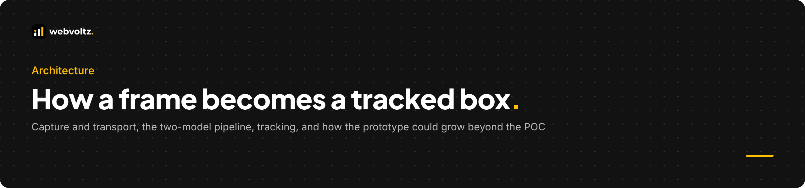
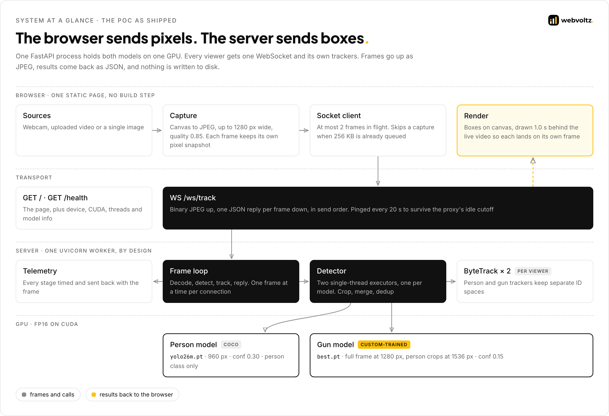
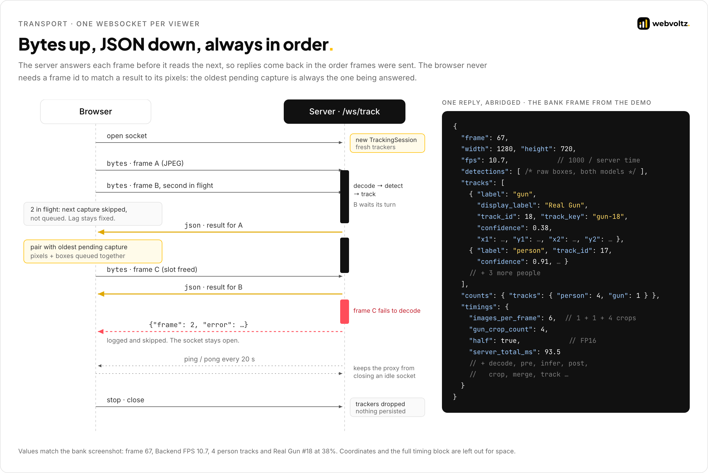
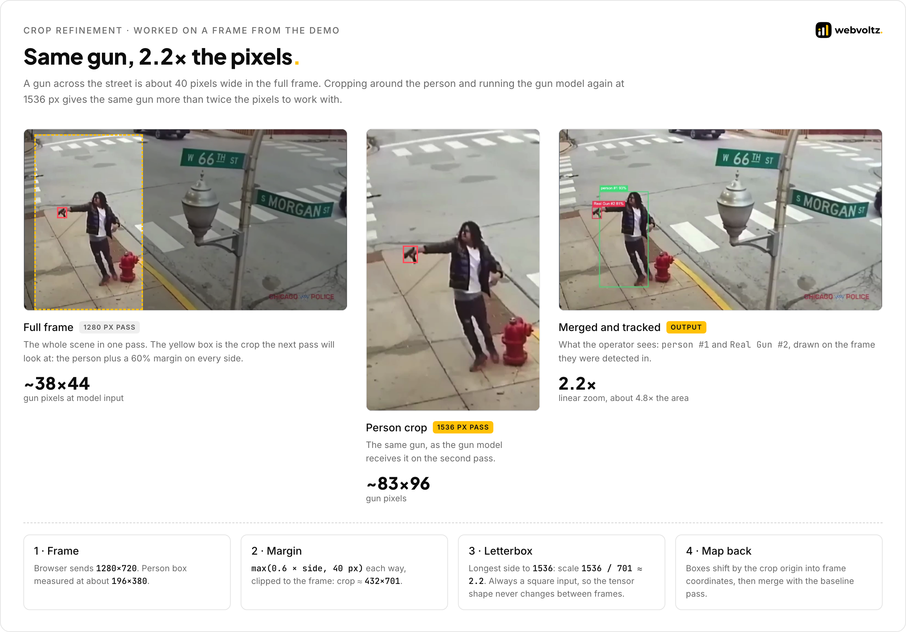
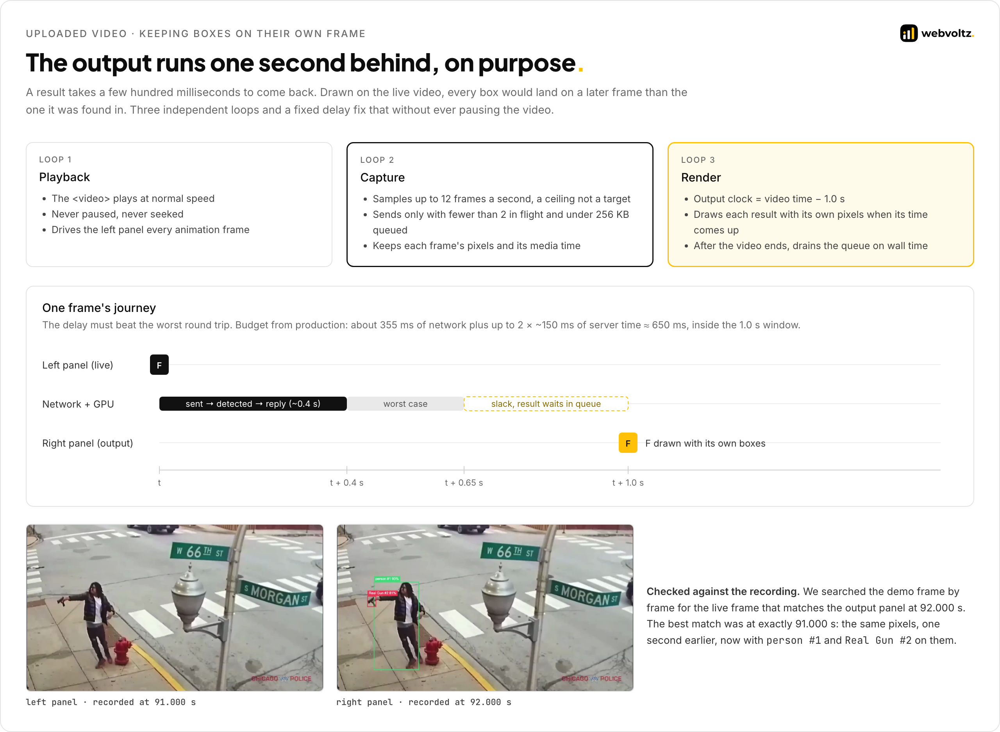
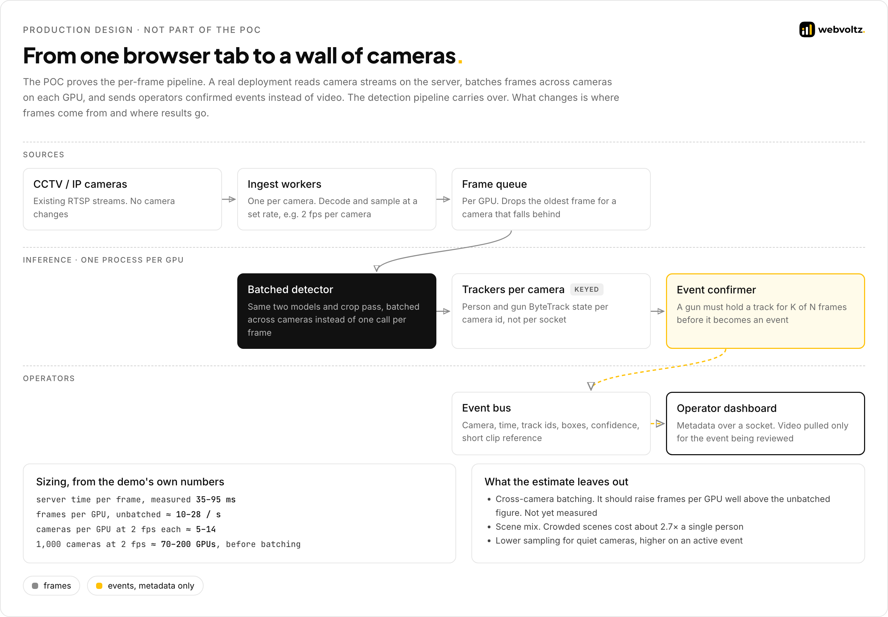

<p align="center">
  
</p>

# Architecture

Netram is a proof of concept. It was built to demonstrate how the solution works, not to be a production-ready product. This document covers how the prototype turns a video frame into tracked boxes. Part 1 is the POC as built. Part 2 sketches how it could grow beyond the POC. None of Part 2 is built.

**Contents**

- [System at a glance](#system-at-a-glance)
- **Part 1 · The proof of concept**
  - [1. Capture in the browser](#1-capture-in-the-browser)
  - [2. One socket per viewer](#2-one-socket-per-viewer)
  - [3. Two models, three passes](#3-two-models-three-passes)
  - [4. Zooming in on people](#4-zooming-in-on-people)
  - [5. One gun, one box](#5-one-gun-one-box)
  - [6. Tracking](#6-tracking)
  - [7. Keeping boxes on their own frame](#7-keeping-boxes-on-their-own-frame)
  - [8. Measuring every stage](#8-measuring-every-stage)
  - [9. Delivery](#9-delivery)
- **Part 2 · Beyond the POC (design only)**
  - [10. From a browser tab to a camera wall](#10-from-a-browser-tab-to-a-camera-wall)
  - [11. What changes in the code](#11-what-changes-in-the-code)
  - [12. Failure modes](#12-failure-modes)
- [Decision log](#decision-log)

---

## System at a glance

<p align="center"></p>

Three rules shape the system:

1. **One process, two models.** Both YOLO models load once at start-up and stay in GPU memory. The server runs a single Uvicorn worker on purpose, because each extra worker would load both models again on the same GPU.
2. **One socket, strict order.** Each viewer gets one WebSocket. The server answers a frame before it reads the next, so replies always arrive in send order.
3. **Nothing on disk.** Frames are decoded in memory, run through the models and dropped. Only boxes, labels and timings leave the server.

---

# Part 1 · The proof of concept

## 1. Capture in the browser

The client is one static HTML page with no framework and no build step. It turns a webcam, an uploaded video or a single image into JPEG frames on a canvas.

| Mode | Max width | JPEG quality | Frames in flight | How a result finds its frame |
| --- | --- | --- | --- | --- |
| Webcam | 960 px | 0.75 | 1 | A snapshot of the exact pixels sent is kept and drawn with its result |
| Uploaded video | 1280 px | 0.85 | 2 | A queue of captures, rendered 1.0 s behind the video ([section 7](#7-keeping-boxes-on-their-own-frame)) |
| Image | 960 px | 0.9 | 1 | One frame. The socket closes after the reply. |

**Why JPEG quality stays high.** Small, distant guns are mostly fine detail, which is the first thing JPEG compression throws away. The crop pass then enlarges exactly those regions, which magnifies the artifacts without recovering the detail. When bandwidth needs cutting, the client sends fewer frames rather than worse ones.

---

## 2. One socket per viewer

<p align="center"></p>

The whole API is three routes: the page, a health probe and the WebSocket. Each connection gets its own trackers, and each frame runs through decode, detect and track before the next one is read.

```python
# src/backend/routes.py
@router.websocket("/ws/track")
async def track_websocket(websocket: WebSocket) -> None:
    await websocket.accept()
    detector = get_detector(websocket)
    session = TrackingSession()
    ...
    while True:
        jpeg_bytes = await websocket.receive_bytes()
        try:
            frame = decode_jpeg(jpeg_bytes)
            detections, timings = await detector.detect_with_timings(frame)
            tracks = session.update(detections, frame)
        except Exception:
            await websocket.send_json({"frame": frame_number, "error": "Failed to process frame."})
            continue
```

Every reply carries the frame size, raw detections, confirmed tracks, per-label counts and a timing breakdown. The browser needs no frame id: the oldest unanswered capture is always the one being answered.

**Keeping the socket alive.** The public URL sits behind a proxy that closes idle connections after about 100 seconds. Uvicorn pings every 20 seconds, so a paused video doesn't drop the connection.

---

## 3. Two models, three passes

<p align="center"></p>

| Model | Weights | Input | Confidence | Classes kept |
| --- | --- | --- | --- | --- |
| Person | `yolo26m.pt`, COCO-pretrained | 960 px | 0.30 | person only |
| Gun | `best.pt`, custom-trained | 1280 px full frame, 1536 px on crops | 0.15 | the gun class, named "Real Gun" |

The person pass and the full-frame gun pass start together, each on its own single-thread executor, so a frame costs roughly the slower of the two rather than their sum.

```python
# src/backend/detector.excerpt.py
coco_future = loop.run_in_executor(self.coco_executor, self.coco_model.predict, frame)
gun_baseline_future = loop.run_in_executor(self.gun_executor, self.gun_model.predict, frame)
(coco_result, person_stats), (gun_baseline_result, gun_stats) = await asyncio.gather(
    coco_future, gun_baseline_future
)
```

**Why a low confidence floor on guns.** At 0.15 the gun model reports weak candidates. The crop pass re-examines them at higher resolution, and the tracker's thresholds decide which ones become tracks. Filtering hard at the first pass would throw away exactly the small, partly hidden guns this system exists to find.

**FP16 on CUDA.** Half precision is switched on automatically when the device is a CUDA GPU, and left off on CPU and Apple Silicon, where it is slower or unsupported.

---

## 4. Zooming in on people

<p align="center"></p>

If the person pass finds anyone, the gun model runs a second time on a crop around each of the 4 most confident people. Each box grows by 60% of its width and height on every side, with a 40 px minimum, and is clipped to the frame.

```python
# src/backend/detector.excerpt.py
pad_x = max(width * GUN_CROP_MARGIN_RATIO, GUN_CROP_MIN_PADDING_PX)
pad_y = max(height * GUN_CROP_MARGIN_RATIO, GUN_CROP_MIN_PADDING_PX)
```

All crops go to the GPU in one batched call. A crop's boxes are shifted by the crop's origin back into full-frame coordinates.

**The 1.5-second stall.** Early on, frames with exactly one crop sometimes took about 1.5 s, while frames with several crops took about 10 ms per image. The cause was the input shape. With a single crop, Ultralytics letterboxes to a rectangle that matches that crop's shape, so the tensor shape changed on almost every frame, and each new shape made CUDA re-select its kernels and allocate fresh memory. Forcing a square input (`rect=False`) for every crop batch gives one constant shape, and the stalls stopped. Full frames keep the rectangular letterbox: their shape is already stable for a given source, and 1280×736 is cheaper than 1280×1280.

---

## 5. One gun, one box

The two passes often box the same gun very differently. The full frame might catch only the grip, while the zoomed crop catches grip and barrel. Their overlap can fall below any sensible IoU threshold, so plain deduplication keeps both, and the tracker then follows one gun as two.

The fix is to trust the closer look. Any full-frame gun whose centre falls inside a region that was re-examined at higher resolution is dropped, and only then are the remaining boxes deduplicated.

```python
# src/backend/detector.excerpt.py
surviving_baseline = [
    detection
    for detection in baseline_gun_detections
    if not self._point_in_any_region(
        (detection.x1 + detection.x2) / 2, (detection.y1 + detection.y2) / 2, refined_regions
    )
]
gun_detections = self._dedup_gun_detections([*surviving_baseline, *refined_gun_detections])
```

The dedup is greedy: sort by confidence, keep a box unless it overlaps an already kept box above IoU 0.5. That handles two overlapping person crops that both found the same gun.

---

## 6. Tracking

Each viewer's session runs two ByteTrack instances, one for people and one for guns. They have separate settings and separate ID counters, so `person #3` and `Real Gun #3` are never confused.

| Setting | Person tracker | Gun tracker | Why they differ |
| --- | --- | --- | --- |
| High threshold (first association) | 0.6 | 0.3 | Guns score lower even when the detection is right |
| Low threshold (second association) | 0.1 | 0.1 | ByteTrack also matches low-score boxes to existing tracks, which keeps a track alive through blur and partial cover |
| New track threshold | 0.4 | 0.3 | |
| Lost-track buffer | 120 frames | 120 frames | An ID survives a person walking behind another |
| Match threshold | 0.9 | 0.9 | |

```python
# src/backend/tracking.py
class TrackingSession:
    def __init__(self) -> None:
        PersonSTrack.reset_id()
        GunSTrack.reset_id()
        self.person_tracker = create_tracker(PersonSTrack, BYTETRACK_CONFIG_PATH)
        self.gun_tracker = create_tracker(GunSTrack, BYTETRACK_GUN_CONFIG_PATH)
```

**What the demo shows.** In the close-up clip, `person #1` and `Real Gun #1` hold their IDs for all 14 seconds. In the same clip, a second armed man keeps `person #12` throughout, but his gun's ID changes from #8 to #14 to #17 as it is hidden and reappears. Person tracks are more stable than gun tracks. Tying each gun to the person carrying it is the next step ([Known limits](SECURITY-AND-PERFORMANCE.md#known-limits)).

---

## 7. Keeping boxes on their own frame

<p align="center"></p>

An uploaded video runs three loops that never block each other:

- **Playback.** The video plays at normal speed and is never paused or seeked.
- **Capture.** Samples frames at up to 12 a second, but only sends when fewer than 2 frames are in flight and less than 256 KB is waiting in the socket's buffer. A frame that can't be sent is skipped, not queued, so the lag never grows.
- **Render.** Draws the right panel on its own clock, one second behind the video.

```js
// src/frontend/videoPipeline.excerpt.js
if (!sourceVideo.ended) {
  outputClock = sourceVideo.currentTime - outputDelaySeconds;
}
// ...
while (renderQueue.length && renderQueue[0].time <= outputClock) {
  if (currentOutputEntry) currentOutputEntry.bitmap.close();
  currentOutputEntry = renderQueue.shift();
}
```

Each capture keeps its own pixel snapshot and media time. When its result arrives, the pair waits in a queue until the output clock reaches it. The delay has to be longer than the worst round trip: the budget is about 355 ms of network plus up to 2 frames of about 150 ms of server time, roughly 650 ms, inside the 1.0 s window.

**Why 2 frames in flight, not 4.** We tried 4. Every extra frame in flight is another frame per second the server has to resize and copy to the GPU, and that preprocessing runs on the CPU. On the production pod, preprocessing time went from about 20 ms to more than 2 seconds at times, far worse than the throughput it bought.

---

## 8. Measuring every stage

Every reply carries its own timings, and the client logs them with its side of the trip:

```text
timing     round=412ms server=93ms net+queue=319ms | images=6 infer=… pre=… post=… fp16=on
           | person=… gun=… par=… crop=…x4 | decode=… extract=… merge=… track=… encode=…ms sendq=0KB 98KB
```

The format is real. The numbers are for illustration only. The fields answer three questions about any slow frame:

- **Network or server?** Round trip minus server time is network plus waiting behind the other frame in flight.
- **Model or overhead?** `infer` is the forward pass alone. `pre` and `post` are resizing, GPU copy and box decoding.
- **Parallel or serial?** If `par` tracks the slower of `person` and `gun`, the two passes really overlap. If it tracks their sum, something is serialising them.

The server also synchronises CUDA after each model call before reading the clock. CUDA queues work asynchronously, so without the sync the forward pass would appear to cost almost nothing and its time would show up later in an unrelated stage.

---

## 9. Delivery

<p align="center"></p>

| Step | What it does | What it prevents |
| --- | --- | --- |
| Isolated Docker config per CI job | Registry credentials live in a directory named after the job id | Another project's job on the shared runner logging ours out mid-push |
| LFS check | Fails if either weights file is under 1 MB | Shipping a 130-byte Git LFS pointer instead of the model |
| Torch freeze | Records the base image's CUDA torch build as a constraint before installing anything else | A dependency pulling in a CPU-only torch, which would make the pod run every frame on the CPU |
| CUDA assertion | The build fails unless `torch.version.cuda` is set | The same failure, caught at build time instead of in production |
| Push with retry | Up to 5 attempts with backoff, resuming layer by layer | Restarting a 5 GB upload from zero |
| CUDA 12.8 base | One image covers RTX 4090 and RTX 5090 | A second image per GPU generation |
| Auto-terminate | Every pod is created with a kill time, 9 hours by default | A forgotten GPU billing all week |

---

# Part 2 · Beyond the POC

> Design only. None of this is built. It shows how the prototype could grow if it moved toward production, reusing the detection pipeline from Part 1 and sized against the POC's measured numbers.

## 10. From a browser tab to a camera wall

<p align="center"></p>

| Stage | Responsibility |
| --- | --- |
| Ingest workers | One per RTSP camera. Decode on the server and sample at a set rate. Reconnect with backoff when a camera drops. |
| Frame queue | One per GPU. Holds the latest frames per camera and drops the oldest for a camera that falls behind, so no camera can starve the others. |
| Batched detector | The same two models and crop pass, run on a batch of frames from many cameras in one call. |
| Trackers per camera | Person and gun ByteTrack state keyed by camera id. |
| Event confirmer | A gun becomes an event only after its track holds for K of N frames. |
| Event bus and dashboard | Operators get camera, time, track ids, boxes and confidence. Video is pulled only for the event being reviewed. |

**Sizing.** Unbatched, the measured 35–95 ms per frame gives about 10–28 frames per second per GPU. At 2 frames per second per camera, that is about 5–14 cameras per GPU, and about 70–200 GPUs for 1,000 cameras. Batching across cameras should improve on this considerably. We have not measured it yet, so we don't count it.

---

## 11. What changes in the code

| POC | Production | Why |
| --- | --- | --- |
| Browser pushes JPEG frames | Server pulls RTSP streams | No browser per camera, no JPEG round trip, no public upload path |
| One `TrackingSession` per socket | Trackers keyed by camera id | A camera's tracks outlive any viewer |
| Process-wide track ID counters | Counters owned by each tracker instance | Concurrent cameras must not share or reset each other's IDs |
| Decode, merge and tracking on the event loop | All CPU work in worker processes | One busy camera must not delay another camera's I/O |
| One executor thread per model | Batched inference across cameras | Higher GPU utilisation per frame |
| Boxes drawn for every frame | Confirmed events only | Operators review alerts, not every detection |

---

## 12. Failure modes

| Failure | Effect | Response |
| --- | --- | --- |
| GPU visible but unusable in the container | Every frame would fail or crawl on the CPU | The POC probes the device at start-up and falls back to CPU with one clear warning. `/health` reports the device actually in use. |
| A frame fails to decode or infer | One missing result | The frame is reported and skipped. The socket and its trackers stay up. |
| The proxy closes an idle socket | The client loses its connection | WebSocket pings every 20 seconds |
| The socket dies mid-video | The output panel could wait forever | The render loop finishes what it has and stops instead of hanging |
| A slow uplink | Lag would grow without bound | 2 frames in flight, a 256 KB send cap, skipped captures |
| A camera goes offline *(design)* | No frames from that camera | The ingest worker reconnects with backoff and raises a camera-health event |
| A GPU node fails *(design)* | Its cameras stop being analysed | Its cameras move to other nodes' queues. Trackers restart for those cameras with fresh IDs. |
| A burst of false positives *(design)* | Alert fatigue | K-of-N confirmation before an event, and human review of every event |

---

## Decision log

| Decision | Alternatives considered | Why we chose it |
| --- | --- | --- |
| Two specialised models | One model trained on people and guns together | A COCO model is already strong on people. The gun model can be retrained on its own without touching person detection. |
| Crop refinement around people | Slicing the whole frame into tiles | Tiles cost a pass per tile on every frame. Crops only happen where a gun can be, and are capped at 4. |
| Region-based merge, then IoU dedup | IoU-only deduplication | The two passes box the same gun too differently for IoU alone |
| ByteTrack | Trackers with appearance re-identification | No extra model to run per frame, and ByteTrack's use of low-score boxes suits guns |
| Separate person and gun trackers | One tracker for both classes | Different thresholds, and ID spaces that never collide |
| WebSocket with in-order replies | An HTTP request per frame, WebRTC | One connection, no per-request overhead, and pairing by order with no frame ids. WebRTC is heavier than a POC needs. |
| Fixed 1.0 s output delay | Drawing the newest boxes on the live video | Boxes on the live video always describe an earlier frame |
| Skip captures, never queue them | A send queue | A queue turns a slow link into ever-growing lag |
| One Uvicorn worker | Several workers | Each worker would load both models again onto the same GPU |
| FP16 on CUDA | FP32 everywhere | Faster inference on the GPU's FP16 hardware, with no meaningful accuracy loss in detection |
| Weights baked into the image | Download at start-up | A fresh pod needs no network to start, and the weights match the code that was built |
