<p align="center">
  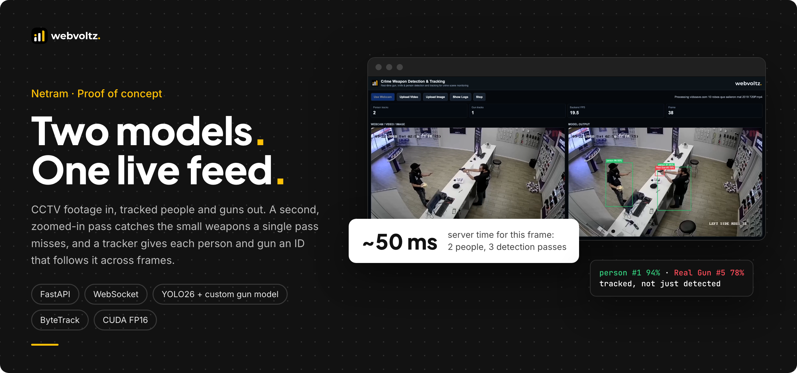
</p>

<p align="center">
  <a href="#what-we-built">What we built</a> ·
  <a href="#by-the-numbers">By the numbers</a> ·
  <a href="ARCHITECTURE.md">Architecture</a> ·
  <a href="SECURITY-AND-PERFORMANCE.md">Security and performance</a> ·
  <a href="#risks-and-how-we-handled-them">Risks</a> ·
  <a href="#screenshots">Screenshots</a>
</p>

---

## The outcome

Netram is a proof of concept we built to show how AI can watch CCTV footage in real time. It finds every person and every gun in each frame and follows each one with a track ID while the video keeps playing.

- **Catches small weapons.** A second, zoomed-in pass around each person gives a distant gun about 2.2× the pixels it gets in the full frame.
- **Real time on one GPU.** 35–95 ms of server time per frame in the recorded demo, from one person on a street corner to a crowded bank.
- **Boxes land on the right frame.** The output plays exactly one second behind the input, so every box is drawn on the pixels it was found in. We checked this frame by frame against the recording.

> **Scope: a proof of concept.** Netram was built as a prototype to demonstrate how the solution works end to end. It implements the core functionality: detection, tracking and a live demo interface. It was never meant to be a production-ready product. Authentication, multi-camera ingest, alerting and the other things a deployment needs are described below as next steps, not as shipped features.

> This repository is a technical case study. It shows how we structure, write and ship this kind of system through selected excerpts, diagrams and recordings. The full source is not published. See [Notice](#notice).

---

## The problem

CCTV networks have far more cameras than people to watch them. An AI pass that flags weapons has to solve three problems at once:

1. **Small objects.** A handgun across a street is a few dozen pixels wide in a 1280-pixel frame. A single detection pass at normal resolution misses many of them.
2. **Identity over time.** A detector sees each frame alone. An operator needs to know that the gun in this frame is the same gun as a second ago, and which person is carrying it.
3. **Latency you can see.** Results take a few hundred milliseconds to come back over a network. Drawn on the live video, every box would sit on a later frame than the one it describes.

---

## What we built

### Live detection on real CCTV

Upload a recording or open a webcam. The left panel plays the input. The right panel shows the same frames with every person in green and every gun in red, each with a track number and a confidence score. The counters at the top show tracked people, tracked guns, backend speed and the frame number.

<p align="center">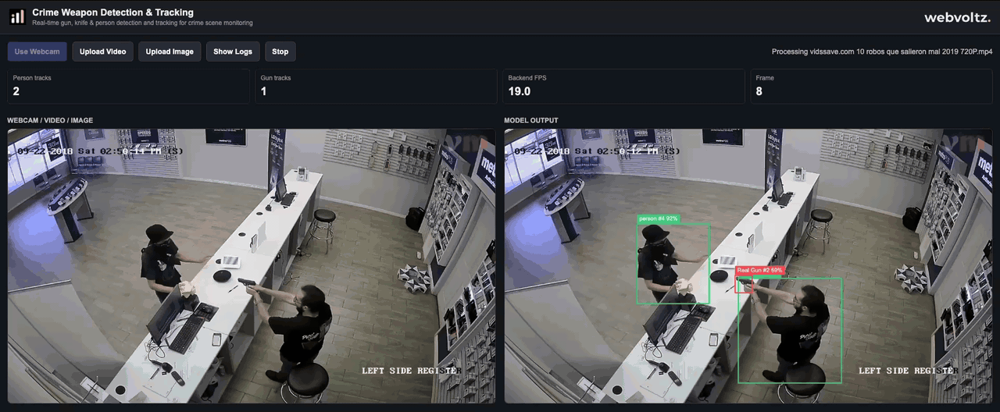</p>

### Small guns, found by zooming in

The pipeline finds people first, then crops around each of them with a 60% margin and runs the gun model again at 1536 px. In this clip, `person #1` and `Real Gun #1` keep their IDs for all 14 seconds. The gun model's class is named "Real Gun", so that is what the labels say.

<p align="center">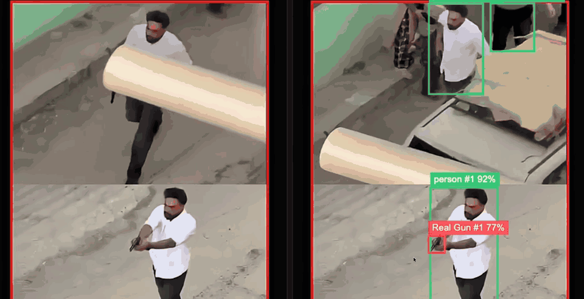</p>

### Crowds, at a bounded cost

Every extra person adds a crop, so a crowded frame costs more. The crop pass is capped at the 4 most confident people, so a crowd can't push latency without limit. A bank heist with 4 or more people in view ran at about 90 ms per frame.

<p align="center">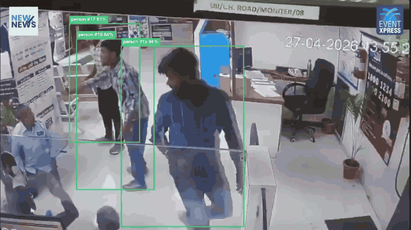</p>

### Street cameras at a distance

A high, wide street camera is the hard case for small objects. Here a person on a street corner is tracked as `person #1`, and the gun in their outstretched hand as `Real Gun #2`, at about 35 ms per frame.

<p align="center">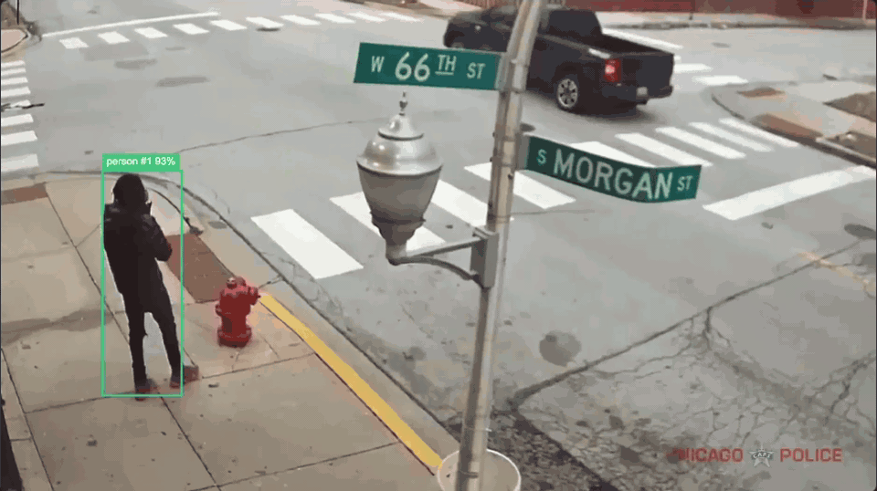</p>

### Low light and fast action

The same pipeline runs unchanged on dim, compressed indoor footage and on a fast parking-lot incident.

<table>
  <tr>
    <td width="50%">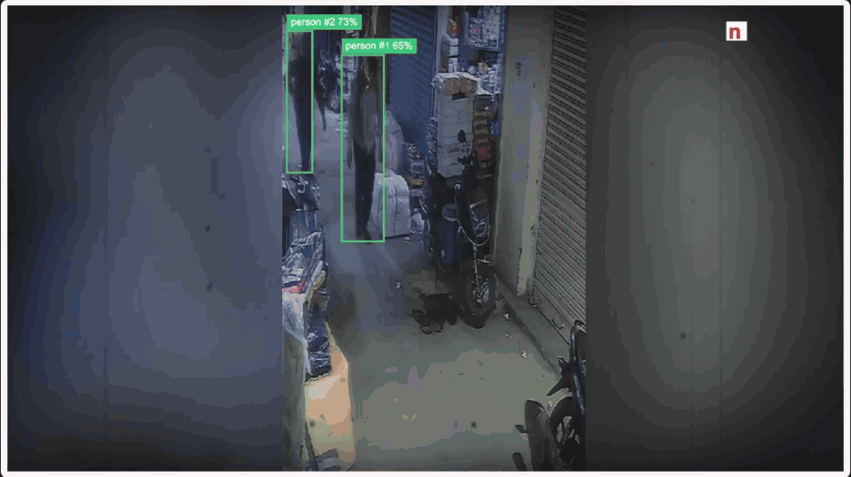</td>
    <td width="50%">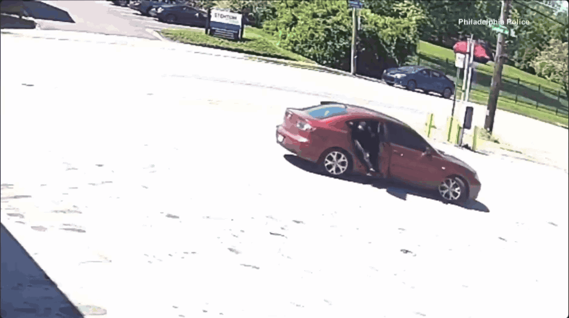</td>
  </tr>
</table>

---

## By the numbers

<p align="center"></p>

Server times come from the app's own per-frame telemetry, recorded in the demo. The method for every figure is in [Security and performance](SECURITY-AND-PERFORMANCE.md#how-we-measured).

---

## How it's engineered

<p align="center"></p>

| Area | Decision | Why |
| --- | --- | --- |
| Detection | Two models: YOLO26m (COCO, person class only) and a custom-trained gun model | A general model is already good at people. Guns need a dedicated model with a low confidence floor. |
| Small objects | Re-run the gun model on crops around up to 4 people, at 1536 px | The zoom only happens where a gun can be, and the cost stays bounded in a crowd. |
| Merging | A crop's result replaces any full-frame gun whose centre falls inside that crop | The two passes box the same gun differently, so IoU alone kept both and tracked one gun as two. |
| Tracking | Two ByteTrack instances per viewer, one for people and one for guns | Separate thresholds for small, low-scoring guns, and ID spaces that never mix. |
| Transport | One WebSocket per viewer. JPEG up, JSON down, answered strictly in order | The browser pairs each result with its frame without needing a frame id. |
| Sync | The output panel runs a fixed 1.0 s behind the input | Every box is drawn on the exact pixels it was detected in. |
| GPU | FP16 on CUDA, a fixed square shape for crop batches | Half-precision speed, and no shape changes that force the GPU to re-plan between frames. |

The full write-up, with excerpts, is in **[ARCHITECTURE.md](ARCHITECTURE.md)**.

---

## Beyond the POC

*Not built. This section shows how the prototype could grow if it moved toward production.*

The POC takes frames from a browser tab. A real deployment would read camera streams on the server and send operators confirmed events, not video. We sketched that path and sized it against the demo's measured numbers.

<p align="center"></p>

- **Ingest on the server.** One worker per RTSP camera would sample frames at a set rate. Cameras would need no changes.
- **Batch across cameras.** One process per GPU would run the same two models and crop pass on frames from many cameras at once.
- **Confirm before alerting.** A gun would have to hold its track for K of N frames before it becomes an event, which filters single-frame false alarms.
- **Send metadata, not video.** Operators would get the camera, time, track ids and boxes, and pull video only for the event being reviewed.

---

## Engineering standards

<p align="center"></p>

- **CUDA checked at build time.** The base image's torch build is frozen into a constraints file before anything else installs, and the build fails if a CPU-only torch slips in.
- **No silent weight swaps.** CI fails in seconds if the model weights are Git LFS pointer files instead of real weights.
- **Credentials isolated per job.** Each CI job logs in to the registry with its own Docker config, so another project's job on the shared runner can't log ours out mid-push.
- **Pinned to the training version.** Ultralytics is pinned to the exact version the gun model was trained on.
- **Pods that turn themselves off.** Every GPU pod is created with an auto-terminate time.

---

## Risks and how we handled them

| Risk | What could go wrong | How we handled it |
| --- | --- | --- |
| Small or distant guns | Missed weapons in wide CCTV shots | Crop refinement around each person at 1536 px, with a 0.15 confidence floor on the gun model |
| One gun counted twice | The full-frame and crop passes each box it, and the tracker gives it two IDs | The crop's result is authoritative for its region, then greedy dedup at IoU 0.5 |
| Crowds blow up latency | Each person adds work to the frame | At most 4 crops per frame, batched into one GPU call |
| Boxes on the wrong frame | Results arrive a few hundred ms late | Each capture keeps its pixels. The output panel plays a fixed 1.0 s behind the input. |
| Backlog builds up | A slow link or GPU makes the lag grow without bound | At most 2 frames in flight and a 256 KB send-buffer cap. Captures are skipped, never queued. |
| GPU stalls | Varying input shapes made some frames take about 1.5 s | A fixed square input for every crop batch |
| GPU silently unused | A container sees the GPU but can't use it, so every frame runs on CPU | A device probe at start-up, a CUDA assertion at build time, and `/health` reporting the device |
| Unattended GPU spend | A forgotten pod bills all week | Auto-terminate time on every pod |

What the POC deliberately leaves out is listed in [Security and performance](SECURITY-AND-PERFORMANCE.md#known-limits).

---

## Screenshots

<table>
  <tr>
    <td width="50%">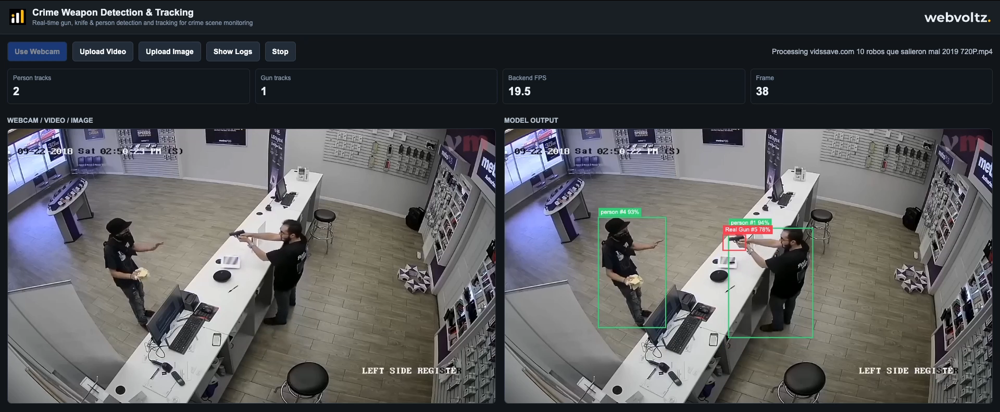</td>
    <td width="50%">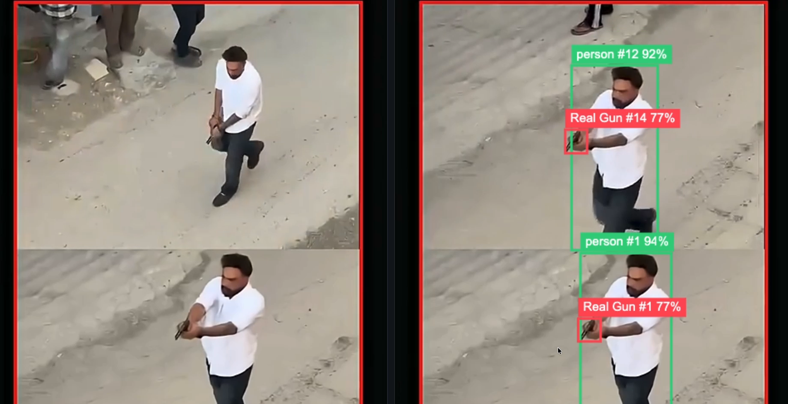</td>
  </tr>
  <tr>
    <td width="50%">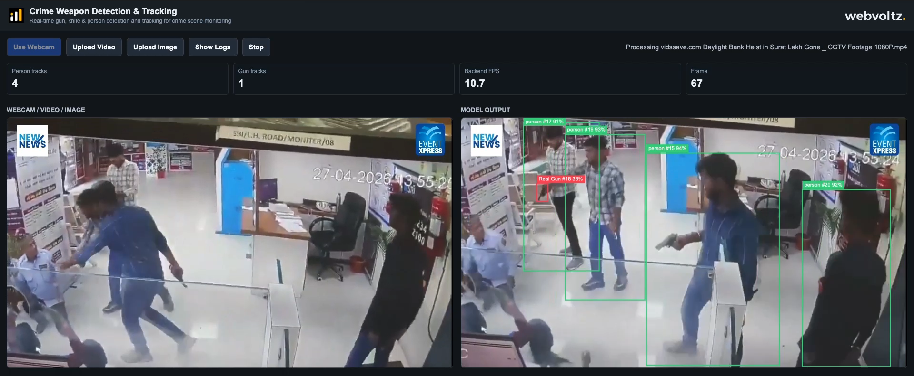</td>
    <td width="50%">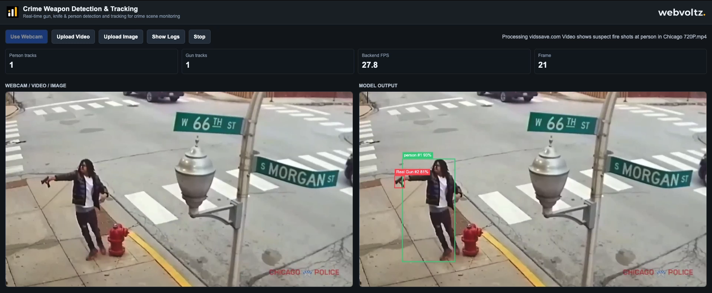</td>
  </tr>
  <tr>
    <td width="50%">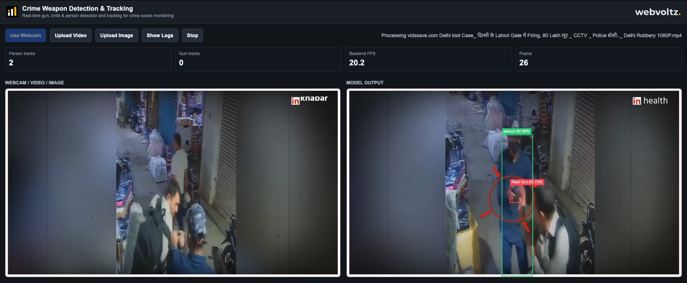</td>
    <td width="50%">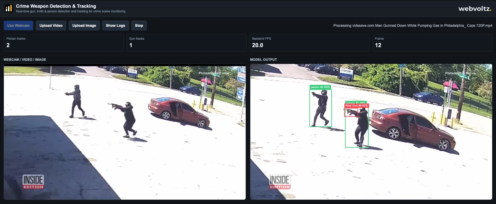</td>
  </tr>
</table>

---

## Repository map

```text
.
├── README.md                       this page
├── ARCHITECTURE.md                 capture, transport, detection, tracking, sync, beyond the POC
├── SECURITY-AND-PERFORMANCE.md     measurements, threat model, limits
├── src/
│   ├── backend/
│   │   ├── routes.py               HTTP + WebSocket routes, one socket per viewer
│   │   ├── detector.excerpt.py     two-model pipeline, crop refinement, merge
│   │   └── tracking.py             ByteTrack sessions, separate person and gun IDs
│   └── frontend/
│       └── videoPipeline.excerpt.js  capture, backpressure and the 1 s synced output
└── assets/                         diagrams, screenshots, GIFs, brand
```

---

## Tech stack

| Layer | Proof of concept (built) | Beyond the POC (design only) |
| --- | --- | --- |
| Client | One static HTML page, vanilla JavaScript, Canvas 2D, no build step | Operator dashboard fed by events |
| Transport | WebSocket, binary JPEG up, JSON down | RTSP ingest on the server, event bus to the dashboard |
| API | FastAPI 0.121, Uvicorn 0.40, one worker | One inference process per GPU |
| Detection | Ultralytics 8.4.126, YOLO26m for people, a custom-trained gun model, OpenCV 4.12 | Same models, batched across cameras |
| Tracking | ByteTrack, two trackers per viewer | Trackers keyed by camera id |
| Runtime | PyTorch 2.11, CUDA 12.8, cuDNN 9, FP16 | Same |
| Delivery | Docker, GitLab CI, RunPod GPU pods (RTX 4090 by default) | Same image, more GPU nodes |

---

## About Webvoltz

Webvoltz builds the technology systems businesses compete, operate and scale on: web platforms, product engineering, automation, integrations and managed delivery teams. One accountable partner from first strategy session to ongoing delivery.

[**Book a strategy call**](https://webvoltz.com) to talk through computer vision, real-time video or AI on live data.

---

## Notice

Copyright © 2026 Webvoltz. All rights reserved.

This repository is published for viewing and evaluation only. The code excerpts, designs, diagrams and recordings may not be copied, modified, redistributed or used in other work without written permission. The demo footage shown in the screenshots and GIFs is publicly available CCTV and news footage owned by its respective rights holders. See [`NOTICE.md`](NOTICE.md).
