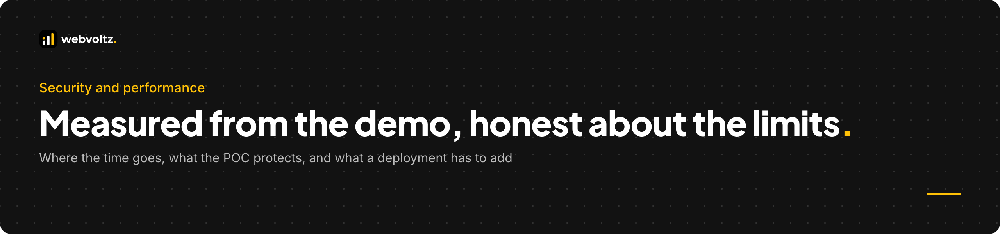
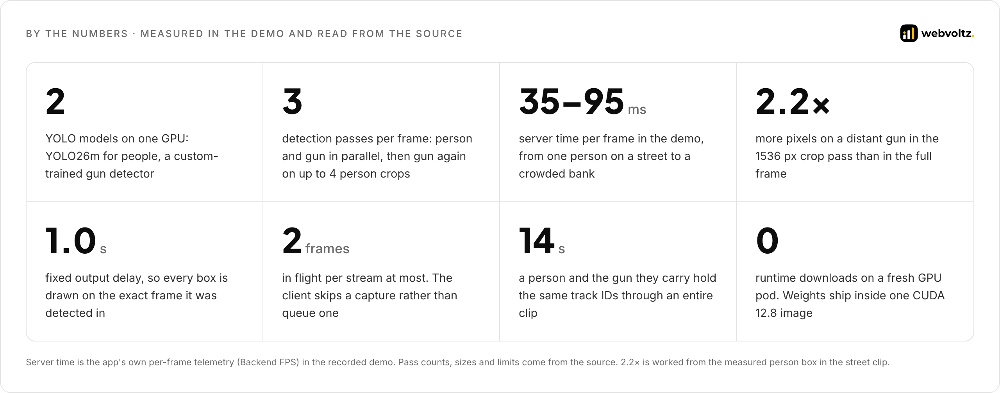
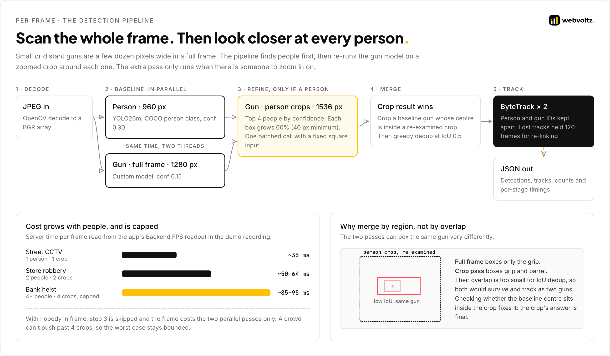
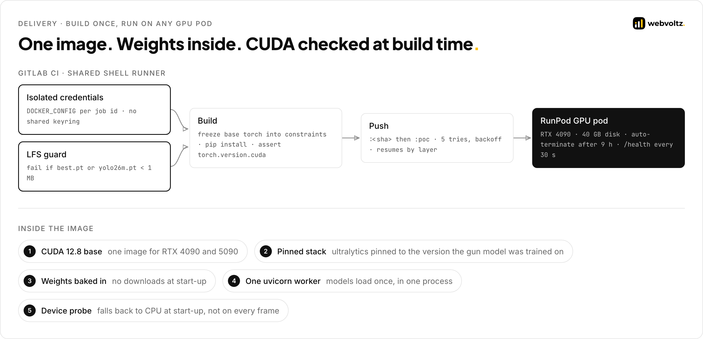

  

# Security and performance

Netram is a proof of concept, built to demonstrate how the solution works. This page covers what we measured in the prototype, what it does to protect footage, and what it deliberately leaves out. Production-grade controls are described as next steps, not shipped features.

**Contents**

- [Performance](#performance)
  - [How we measured](#how-we-measured)
  - [Where the speed comes from](#where-the-speed-comes-from)
  - [Latency budget rules](#latency-budget-rules)
- [Security in the proof of concept](#security-in-the-proof-of-concept)
- [What production would add](#what-production-would-add)
- [Supply chain and delivery](#supply-chain-and-delivery)
- [Known limits](#known-limits)

---

## Performance

### How we measured

All runtime figures come from the recorded demo. The app shows its own **Backend FPS** for every frame, which is 1000 divided by the server's time on that frame. We read that counter every 2 seconds across the recording.

| Metric | Result | Method |
| --- | --- | --- |
| Server time, 1 person (street corner) | 34–36 ms | Backend FPS 27.8–29.3 |
| Server time, 2 people (store) | 48–64 ms | Backend FPS 15.7–20.9 |
| Server time, 4 or more people (bank) | 81–95 ms most of the time | Backend FPS 10.5–12.4, with short stretches at 15–20 |
| Server time, low-light alley | 48–61 ms | Backend FPS 16.3–21.0 |
| Frames analysed per stream, end to end | about 3.5–4 per second | The app's frame counter against the recording clock: 76 frames in 22 s (store), 108 in 28 s (bank), 41 in 10 s (street) |
| Output delay | 1.000 s | The live frame that best matches the output panel at 92.000 s was recorded at exactly 91.000 s |
| Zoom on a distant gun | 2.2× linear | Person box measured in the street clip, run through the crop rules: a 701 px tall crop letterboxed to 1536 px |
| Stable IDs | 14 s | `person #1` and `Real Gun #1` unchanged for the whole close-up clip |

**What end-to-end throughput tells us.** The server needed 35–95 ms per frame, but each stream only completed about 4 frames a second. With 2 frames allowed in flight, that puts the round trip at about half a second, so network time, not the GPU, set the pace for a single stream over the public internet. The GPU had headroom for more streams.

**What we did not measure.** The recording doesn't show which GPU served it. The deployment script defaults to an RTX 4090. We have no published precision and recall for the gun model in this case study, and we did not load-test several viewers at once.

### Where the speed comes from

1. **FP16 on the GPU.** Half precision on CUDA. It is off on CPU and Apple Silicon, where it doesn't help.
2. **Parallel first pass.** The person and full-frame gun passes run at the same time on two executor threads.
3. **Extra work only where it pays.** The crop pass runs only when a person is in frame, is capped at 4 people, and sends all crops in one batched call.
4. **One shape for crop batches.** A fixed square input removed stalls of about 1.5 s on frames with a single crop.
5. **Smaller full-frame inputs.** Full frames keep a rectangular letterbox: a 16:9 frame becomes 1280×736, not 1280×1280.
6. **A capped CPU thread pool.** Torch uses half the CPU cores per operation, because two models run at once and would otherwise fight over every core.
7. **A client that doesn't pile up work.** At most 2 frames in flight and a 256 KB send cap. Frames are skipped, never queued.

### Latency budget rules

These are the rules the codebase follows. There is no automated test suite yet, so each one is held by the code itself and a comment that records why.

| Rule | Where it lives |
| --- | --- |
| At most 2 frames in flight per stream | `maxInFlight` in the client, with the 20 ms → 2 s preprocessing regression that justified it |
| Cut bandwidth with fewer frames, never lower JPEG quality | `captureFps` and `videoJpegQuality` in the client |
| Crop batches always use one input shape | `rect=False` in the batched predict call |
| Every stage reports its own time | The `timings` block in every reply |
| No runtime tuning flag without before/after timings | A note in the config on a CUDA memory flag that was tried, didn't help and was removed |

---

## Security in the proof of concept

The POC is a demo service. It has no accounts and no stored data. Its exposure is the footage sent to it and the GPU behind it.

| Concern | Control |
| --- | --- |
| Footage at rest | Frames are decoded in memory and never written to disk. Inference runs with saving disabled. |
| Footage in transit | The page opens its socket on the same origin, so it uses `wss://` behind the HTTPS proxy |
| What leaves the server | Boxes, labels, confidence, track numbers and timings. Never pixels. |
| Identity | No face recognition and no identity lookup. Track ids are numbers that last only as long as the session. |
| Malformed frames | A frame that fails to decode or infer gets an error reply and is skipped. The log records the frame number, not the image. |
| API surface | Three routes. The OpenAPI schema and docs pages are switched off. |
| A GPU that silently doesn't work | A start-up probe and `/health` show which device is actually in use |

**What the POC deliberately leaves out.** Authentication, an `Origin` check on the socket, per-client rate limits and a frame-size cap below Uvicorn's default 16 MB message limit. Anyone with the pod URL can use the GPU while the pod is up. Pods are short-lived and auto-terminate. All of these are out of scope for a prototype. A deployment would add them, as the next section describes.

---

## What production would add

> Not built. These are the controls a deployment would need beyond the POC. See [Architecture, Part 2](ARCHITECTURE.md#part-2--beyond-the-poc).

### Threat model

| Threat | Impact | Control |
| --- | --- | --- |
| Unauthorised viewers | Live CCTV and alerts exposed | SSO for operators, role-based access per site and camera, an audit log of every view |
| Camera credentials leaked | Direct access to camera streams | RTSP credentials in a secrets manager, read only by ingest workers. Never sent to the dashboard. |
| Footage retained too long | Privacy and legal exposure | No frames stored by default. Event clips kept for a set retention period, then deleted automatically. |
| Spoofed or tampered events | False alarms, or real ones hidden | Events signed by the inference tier. The dashboard rejects unsigned events. |
| Oversized or hostile input | Memory exhaustion, decoder exploits | Frames come from known camera streams, not uploads. Decoders run in isolated worker processes. |
| False positives | Operators stop trusting alerts | K-of-N confirmation before an event, a human reviews every event, and reviewers' verdicts are logged for retraining |
| Missed weapons | A real incident without an alert | Crop refinement, a low confidence floor, and periodic evaluation on held-out footage from the sites themselves |
| Insider misuse | Surveillance beyond the stated purpose | Purpose-limited roles, audit logs, and no identity features in the pipeline |
| Data residency | Footage leaving the jurisdiction | On-premise or in-region GPU nodes. Only metadata crosses sites. |

### Data handled

The pipeline handles video frames in memory and produces boxes, labels, confidence scores and per-session track numbers. It does not identify people. Event clips, when kept, are the only footage stored, and they fall under the retention policy above.

---

## Supply chain and delivery

| Control | Detail |
| --- | --- |
| Exact pins | Every Python dependency pinned. Ultralytics pinned to the version the gun model was trained on. |
| CUDA build frozen | The base image's torch, torchvision and triton are frozen as constraints before any other install |
| CUDA asserted | The build fails if the installed torch has no CUDA support |
| Weights verified | CI fails if a weights file is a Git LFS pointer instead of the real weights |
| CI credentials isolated | A per-job Docker config, kept outside the build context and deleted after the job |
| Immutable tags | Every build is pushed as its commit SHA, plus a moving `poc` tag for the deploy script |
| Cost guard | Every GPU pod is created with an auto-terminate time |

---

## Known limits

Most of these are deliberate scope cuts for a proof of concept, not defects in a product. We list them because an engineer evaluating this will find them anyway, and because each one marks the work a production version would need.

| Limit | Detail | What closes it |
| --- | --- | --- |
| One viewer per process | Track ID counters are class-level and reset when a new session opens. Two viewers at once would share and reset each other's ID sequences. | Counters owned by each tracker instance |
| CPU work on the event loop | JPEG decode, result extraction, merging and ByteTrack run on the asyncio loop. A busy stream delays other connections' I/O. | Move them into the executor or a worker process |
| Shared model threads | One executor thread per model serves every connection, so frames from different viewers queue behind each other | Batched inference across streams ([Part 2](ARCHITECTURE.md#part-2--beyond-the-poc)) |
| No authentication or rate limits | Anyone with the URL can use the GPU while the pod is up | Auth, an `Origin` check, per-client limits and a frame-size cap |
| Gun IDs fragment | A gun that is hidden and reappears can get a new ID (#8 → #14 → #17 in the close-up clip) while its carrier's person ID holds | Link each gun to the person carrying it, and tune the gun tracker |
| Misses and weak hits | The bank screenshot shows a pistol in plain view with no gun box on that frame, and a 38% gun track elsewhere | More training data from CCTV angles, and K-of-N confirmation before alerting |
| Guns only | The page subtitle mentions knives, but no knife model ships | A knife class and training data |
| No automated tests | Verified through per-frame telemetry and recorded runs | Unit tests for crop, merge and dedup, plus golden-frame regression tests |
| Browser-pushed frames | About 4 analysed frames per second per stream over the public internet | Server-side RTSP ingest |
| No published accuracy figures | This case study reports speed and behaviour, not precision and recall | Evaluation on a held-out set of footage from the target cameras |
